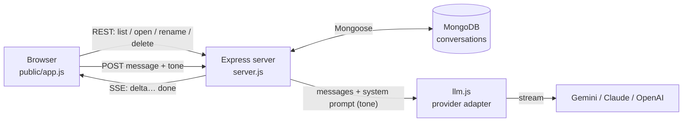

# AI Chat Assistant

A full-stack AI chat app. Replies **stream in character by character**, you can switch the **tone** (Professional / Casual / Concise) at any point, and every conversation is **saved in MongoDB** and listed in a history sidebar.

Built with **Node.js + Express**, **MongoDB (Mongoose)** and **vanilla JavaScript**. There's no frontend build step. The AI provider is pluggable: **Google Gemini** (default), **Anthropic Claude** or **OpenAI**, plus a **mock** mode that needs no API key.

---

## Features

### Core
| Feature | How it works |
|---|---|
| **Chat interface** | Scrollable chat with separate user and AI bubbles, timestamps, auto-growing input box (Enter sends, Shift+Enter adds a new line) |
| **Streaming replies** | The server streams model output to the browser as Server-Sent Events. The client shows it with a smooth typewriter effect |
| **Tone toggle** | Professional / Casual / Concise buttons in the header. The selected tone is sent with every request and becomes the model's **system instruction**, so the **very next reply** changes style. Each message stores the tone it used and shows it as a badge |
| **Conversation history** | The sidebar lists every saved chat, newest first. Click one to reopen it and keep chatting with full context |
| **MongoDB persistence** | Every prompt and reply is saved with its role, content, tone and timestamp. Conversations are auto-titled from the first message |

### Extra features
1. **Markdown with syntax-highlighted code blocks and one-click Copy.** Replies render headings, lists, tables and code (sanitised with DOMPurify, highlighted with highlight.js). Each code block has a Copy button.
2. **Stop and Regenerate.** While a reply streams, **Send** becomes **Stop**. Stop cancels the request to the AI provider and saves the partial reply, marked "stopped". **Regenerate** answers the last prompt again; change the tone first to get the same answer in a different style. The old reply is only replaced once the new one arrives. If a reply fails, a **Retry** link appears under your prompt.

### Smaller extras
Rename and delete chats, sidebar search, copy a whole reply, dark mode (follows your system setting), phone layout with a slide-out sidebar, suggested starter prompts, and readable error messages.

---

## Tech stack

| Layer | Technology |
|---|---|
| Frontend | HTML, CSS, vanilla JavaScript; [marked](https://marked.js.org/), [DOMPurify](https://github.com/cure53/DOMPurify) and [highlight.js](https://highlightjs.org/) loaded from a CDN |
| Backend | Node.js 18+, Express 5 |
| Database | MongoDB with Mongoose 8 |
| AI | `@google/genai` (Gemini), `@anthropic-ai/sdk` (Claude), `openai` (OpenAI), all official SDKs |
| Streaming | Server-Sent Events over `fetch` and a `ReadableStream` |

---

## How it fits together



1. The browser sends `{ content, tone }` to `POST /api/conversations/:id/messages`.
2. The server saves the user message, then calls `streamReply()` in `llm.js` with the last 40 messages as context.
3. `llm.js` turns the tone into a system instruction and streams from the configured provider.
4. Each chunk is forwarded to the browser as an SSE `delta` event. When the reply ends, the server saves it and sends a `done` event.
5. If the browser disconnects (Stop button or closed tab), the server cancels the request to the provider and saves the partial reply.

---

## Project structure

```
ai-chat-assistant/
├── server.js               # Express app: REST API, SSE streaming endpoint, MongoDB connection
├── llm.js                  # AI provider adapter (gemini | anthropic | openai | mock) + tone prompts
├── models/
│   └── Conversation.js     # Mongoose schema: conversation → embedded messages
├── public/
│   ├── index.html          # App layout: sidebar, header with tone toggle, messages, composer
│   ├── style.css           # Styles, dark mode, phone layout
│   └── app.js              # Frontend logic: history, streaming, Markdown, Stop/Regenerate
├── .env.example            # Template for environment variables (copy to .env)
├── .gitignore              # Keeps node_modules/ and .env out of git
├── package.json
└── README.md
```

---

## Getting started

### Prerequisites
- **Node.js 18 or newer**: check with `node --version`
- **MongoDB**: one of
  - local MongoDB Community Server (`mongod`)
  - Docker: `docker run -d -p 27017:27017 --name mongo mongo`
  - a free [MongoDB Atlas](https://www.mongodb.com/atlas) cluster (use its connection string)
- **An API key** for one provider (or use `mock` mode):
  - Gemini: https://aistudio.google.com/apikey
  - Anthropic: https://console.anthropic.com/
  - OpenAI: https://platform.openai.com/api-keys

### 1. Install
```bash
git clone https://github.com/navadheer23361/quantifi-ai-navadheerkumarvulli.git
cd quantifi-ai-navadheerkumarvulli
npm install
```

### 2. Configure
```bash
cp .env.example .env            # Windows PowerShell: Copy-Item .env.example .env
```
Open `.env` and set your provider and key:
```env
PORT=3000
MONGODB_URI=mongodb://127.0.0.1:27017/ai_chat

LLM_PROVIDER=gemini
GEMINI_API_KEY=your-gemini-key-here
GEMINI_MODEL=gemini-3.8-flash
```

### 3. Run
```bash
npm start          # http://localhost:3000
npm run dev        # same, but restarts automatically when files change
```
Open **http://localhost:3000** in your browser.

> **No API key yet?** Set `LLM_PROVIDER=mock` to try the whole app with canned streamed replies.

---

## Environment variables

| Variable | Required | Default | Description |
|---|---|---|---|
| `PORT` | no | `3000` | Port the server listens on |
| `MONGODB_URI` | no | `mongodb://127.0.0.1:27017/ai_chat` | MongoDB connection string |
| `LLM_PROVIDER` | no | `anthropic` | `gemini`, `anthropic`, `openai` or `mock` |
| `GEMINI_API_KEY` | for Gemini | — | Google Gemini API key |
| `GEMINI_MODEL` | no | `gemini-3.8-flash` | Any Gemini model your key can use |
| `ANTHROPIC_API_KEY` | for Claude | — | Anthropic API key |
| `ANTHROPIC_MODEL` | no | `claude-sonnet-4-5` | Claude model ID |
| `OPENAI_API_KEY` | for OpenAI | — | OpenAI API key |
| `OPENAI_MODEL` | no | `gpt-4o-mini` | OpenAI model ID |

---

## Using the app

1. Click **+ New chat** (or just start typing).
2. Pick a **tone** in the header: Professional, Casual or Concise.
3. Type a message and press **Enter**. The reply streams in.
4. Switch tone at any time; the next reply uses the new style.
5. Press **Stop** to cut a reply short, or **Regenerate** to get a new answer to your last prompt.
6. Use the sidebar to **reopen**, **search**, **rename** (✎) or **delete** (🗑) past chats.

---

## API reference

| Method | Endpoint | Body | Response |
|---|---|---|---|
| `GET` | `/api/conversations` | — | List of `{ _id, title, createdAt, updatedAt }`, newest first |
| `POST` | `/api/conversations` | — | `201` new conversation |
| `GET` | `/api/conversations/:id` | — | Full conversation with messages |
| `PATCH` | `/api/conversations/:id` | `{ "title": "..." }` | Updated conversation |
| `DELETE` | `/api/conversations/:id` | — | `204` |
| `POST` | `/api/conversations/:id/messages` | `{ "content": "...", "tone": "casual" }` or `{ "regenerate": true, "tone": "concise" }` | `text/event-stream` (see below) |

**Stream events** (each line is `data: <json>`):
```json
{ "type": "delta", "text": "Hello" }
{ "type": "error", "error": "Gemini is overloaded right now (503). Please press Retry in a moment." }
{ "type": "done",  "message": { "_id": "...", "role": "assistant", "content": "...", "tone": "casual", "stopped": false, "createdAt": "..." }, "title": "..." }
```

**Errors:** `400` invalid ID, empty message, message over 8000 characters, empty title, or nothing to regenerate · `404` conversation not found.

---

## Data model

```js
Conversation {
  title: String,                 // auto-set from the first message, editable
  messages: [{
    role: 'user' | 'assistant',
    content: String,             // the prompt or the AI reply
    tone: 'professional' | 'casual' | 'concise',
    stopped: Boolean,            // true if the reply was cut short with Stop
    createdAt: Date
  }],
  createdAt: Date,
  updatedAt: Date                // used to sort the history sidebar
}
```

---

## Testing

The project was tested end to end on localhost:

- **Browser flow** (headless Edge): New Chat → Select Tone → Send → Streamed reply → Saved → Refresh → Open from history → Follow-up → Regenerate → Stop → Search → Rename → Delete, at both desktop and phone (390px) sizes, with no console errors.
- **API:** every endpoint, saving to the database, tone stored per message, Stop saving partial replies, all `400`/`404` error cases, deleting a chat while it streams, and a missing API key.
- **Live Gemini:** streamed replies in all three tones, follow-up questions that use earlier context, Regenerate in a different tone, and Stop.

---

## Troubleshooting

| Problem | Fix |
|---|---|
| `MongoDB connection failed: connect ECONNREFUSED` | MongoDB isn't running. Start `mongod` or the Docker container, or check `MONGODB_URI` |
| `GEMINI_API_KEY is not set` | Add the key to `.env` and restart the server |
| `Gemini is overloaded right now (503)` | Google's servers are busy. Press **Retry**, or set `GEMINI_MODEL` to another model (e.g. `gemini-3.1-flash-lite`) |
| `Gemini error (404): model ... not found` | That model isn't available to your key. Choose another one from Google AI Studio |
| Replies show as plain text, no code colours | The CDN scripts (marked, DOMPurify, highlight.js) were blocked. Check your internet connection |
| Port 3000 already in use | Set a different `PORT` in `.env` |

---

## Security notes

- API keys live only in `.env` on the server. They're never sent to the browser, and `.env` is git-ignored.
- AI replies are rendered as Markdown and **sanitised with DOMPurify** to prevent script injection.
- Input is validated on the server: conversation IDs, an 8000-character message limit, allowed tone values, and a 100 KB request size limit.
- This is a **single-user demo with no login**. Anyone who can reach the server can see all chats, so add authentication and per-user data before deploying it publicly.

---

## Possible improvements

- User accounts and per-user conversation history
- Full-text search across message content (currently searches titles)
- Rate limiting on the chat endpoint
- An automated test suite in the repository
